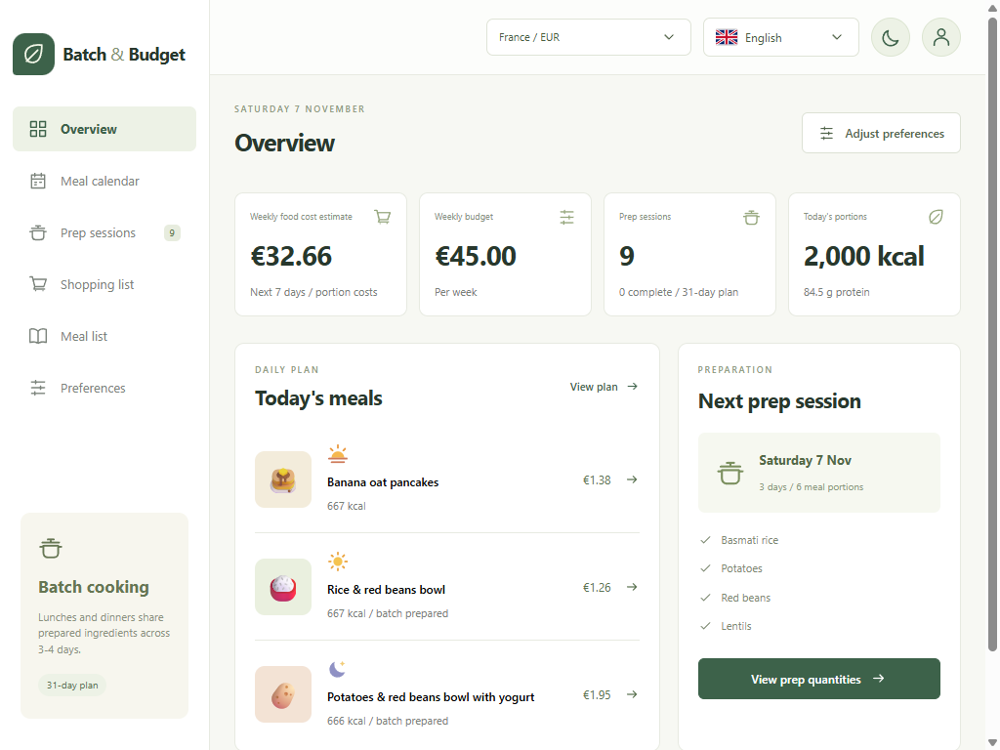
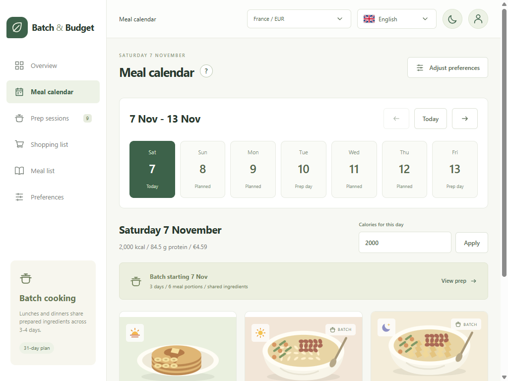
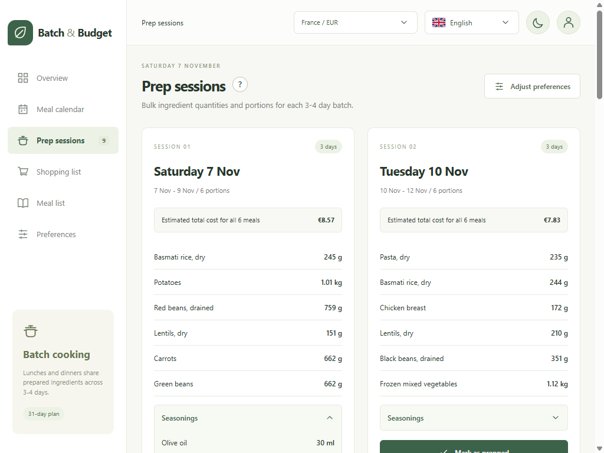
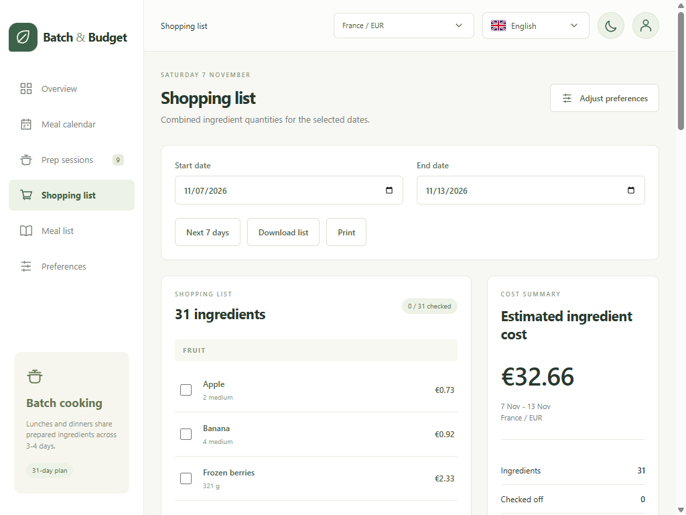
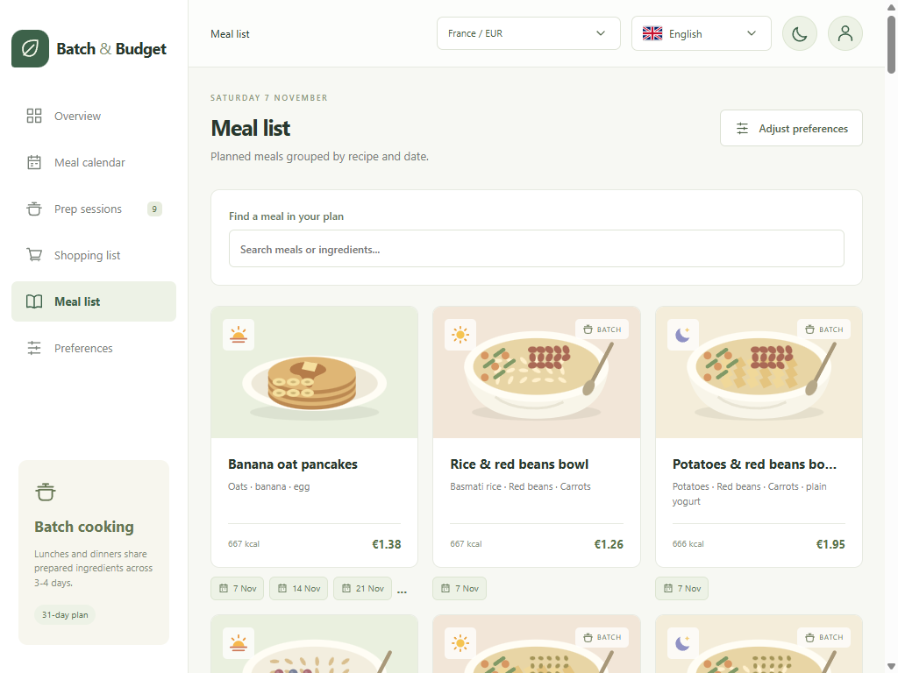
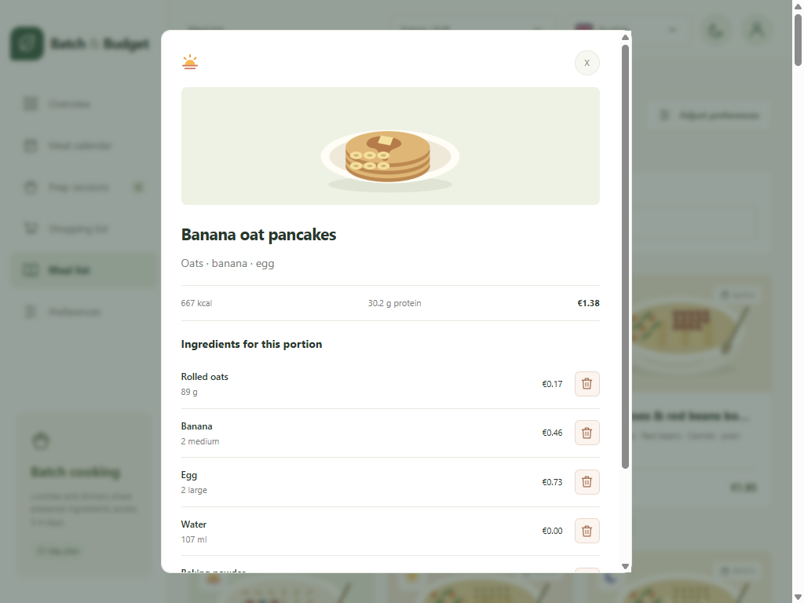
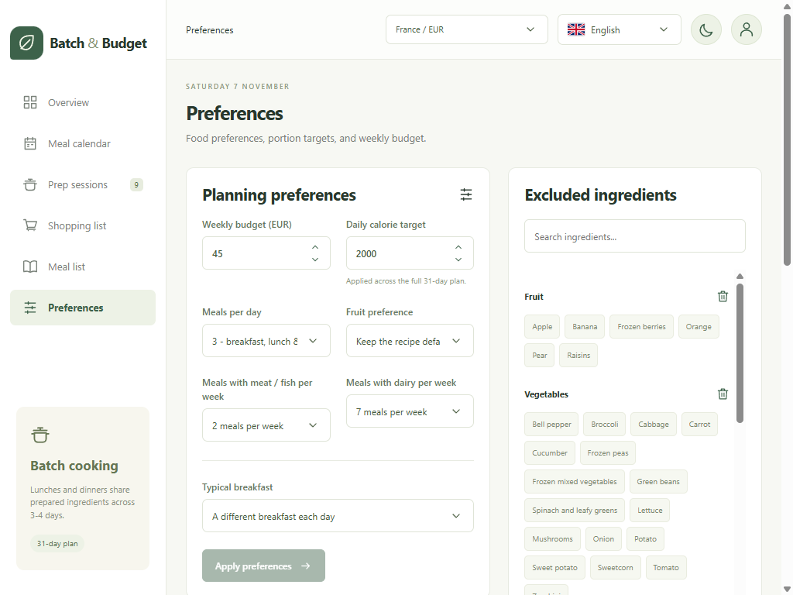
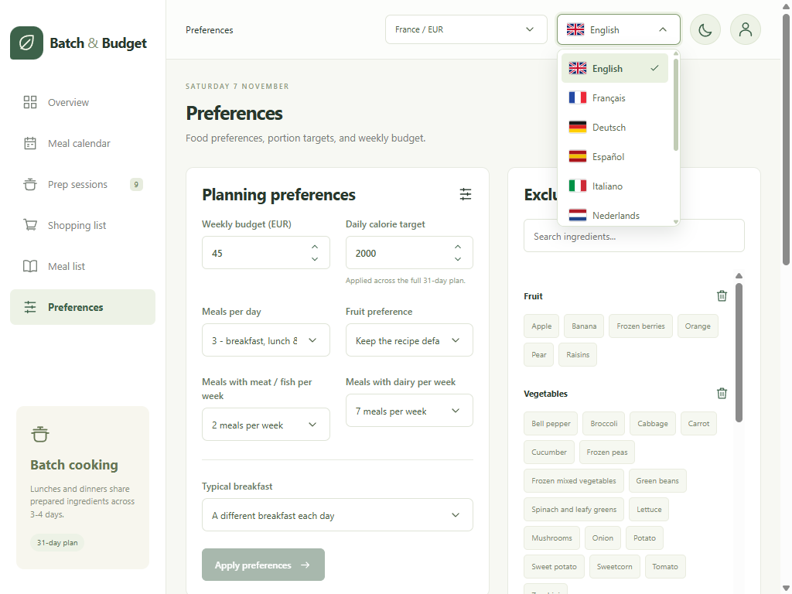
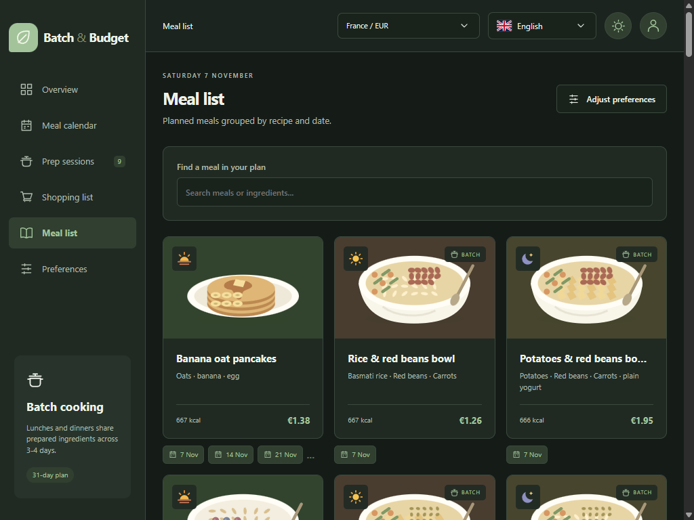

# Batch & Budget

Batch & Budget helps people on a budget plan their weekly food spending and
organize groceries and meal preparation. Its main focus is making batch cooking
easy to plan: reuse ingredients across meals, prepare food in batches for several
days, and build shopping lists around a weekly budget to reduce costs and
repeated preparation.

A standalone Next.js / React / TypeScript web app inspired by the Expo app in
`..\diet`. It runs entirely without a backend. The original app is unchanged.
`backend` is an empty placeholder for a future NestJS service.

## Run

```powershell
npm install
npm run dev
```

Open http://localhost:3000. For production, run `npm run build`, then
`npm start`. No environment variables, accounts, database, or API are needed.

## Pages

Each section has a separate Next.js page and can be opened directly:

- `/` - overview
- `/meal-planner` - meal calendar, daily meals and portions
- `/prep-sessions` - batch preparation
- `/shopping-list` - groceries
- `/menu` - meal list, grouped by recipe and planned dates
- `/preferences` - planning settings and exclusions
- `/about` - app purpose, weekly budgeting, and batch-cooking introduction

Navigation uses browser history and supports back/forward, refresh, and opening
links in new tabs. Saved planner data is shared across sections. Unsaved form
edits, selected dates, and search filters are not persisted across reloads.

## Screenshots

Examples use English with France/EUR and sample planning data.

### Overview

Weekly estimated costs, budget, preparation progress, and today's meals.
The four summary cards link to their corresponding pages.



### Meal calendar

Browse dates and adjust daily calorie targets.



### Prep sessions

Whole-batch costs, ingredient quantities, expandable seasonings, and prep checklists.



### Shopping list

Date-based ingredient totals, estimated costs, and shopping checkboxes.



### Meal list and details

Search planned meals, see their dates, and open a meal's ingredients and actions.





### Preferences and languages

Budget and calorie controls, food preferences, ingredient exclusions, and recipe exclusions.





### Dark mode

The header theme toggle changes the appearance across all pages and dialogs.



## Included

- Light/dark mode defaults to light regardless of operating-system preference; the header
  toggle saves your selection. All pages, dropdowns, and dialogs share the theme.
- The flag language dropdown supports English, French, German, Spanish, Italian,
  Dutch, Russian, Polish, Ukrainian, and Norwegian. Interface, meal content,
  ingredients, messages, dates, and downloaded shopping lists are localized.
  It starts from browser language preferences and saves your selection separately
  from planner data. Language changes do not change country, currency, quantities,
  calorie targets, exclusions, or recipe identities.
- Responsive overview, 31-day meal planner, grouped meal list, batch-prep sessions,
  shopping list, and preferences.
- Meal cards and details use local SVG illustrations selected from the meal
  type and current ingredients, including substitutions. No image service or
  external image downloads are required.
- Dropdowns share styled option lists and open-state arrows, with keyboard
  navigation, type-to-search, and Escape/outside-click dismissal.
- Batch cooking is the only planning style. Lunches and dinners reuse cooked
  components in deterministic 3-4 day batches. Short calendar-edge batches are
  merged and re-split where possible.
  Prep sessions include total quantities for batch components and seasonings
  (in a collapsible section);
  add seasonings when assembling meals.
  Each prep-session price totals all batch meal portions, including seasonings
  and accompaniments, at their applied calorie targets; it is not a per-meal price.
- Weekly budget fitting retains the original compromise ladder (cheaper foods,
  less fruit/meat/dairy, relaxed protein floors, breakfast, then variety).
  Compromises and unattainable budgets are explicitly shown. Calories are never
  reduced to claim a budget fits.
- Two to five meals per day, meat/fish and dairy frequencies, fruit preferences,
  repeating preset or custom breakfasts, ingredient/category exclusions.
  Food frequencies count meals, not ingredients or days, in Monday-based weeks.
  Assigned occurrences rotate between breakfast, lunch, and dinner (no lunch
  for two-meal plans). Dairy can be served as a cold yogurt accompaniment.
  Repeating breakfasts also respect these frequencies; exclusions and budget
  compromises can reduce the number of occurrences.
- Breakfast recipe replacements for one date or all occurrences, recipe bans,
  and restoration. Preferences includes searchable breakfast exclusions.
  Replacement selection defaults to the closest-calorie safe available recipe,
  or a specific recipe can be selected before confirming.
  Batch lunches/dinners are not individually replaceable;
  their ingredients support automatic substitution only. Generated snacks
  cannot be replaced. Ingredient choices for non-batch recipes can skip an
  ingredient or choose a suitable specific substitute.
- Global or per-date calorie portions, modeled protein, country/currency
  estimates, combined ingredient quantities, and exact summed portion costs.
- Shopping ranges within the next 90 days, checklists, text download, and print.
  The calendar covers 31 days; grocery dates beyond it use the engine's
  deterministic calendar-week batches and default 2,000 kcal portions.
- Local browser persistence for preferences, portions, exclusions, shopping
  checkmarks, and completed prep sessions. Plan-affecting changes clear prep
  and shopping checkmarks. Invalid data/storage failures are reported; reset
  requires confirmation. Local dates refresh on focus and each minute.

Country selection changes modeled prices and currency, **not** the numeric
budget target via foreign exchange. Review your target after changing country.
New and reset planners use browser language/region preferences to select a
supported country and its currency. Explicit supported regions take priority,
then supported languages; unmatched locales fall back to France (EUR).
Existing saved selections are preserved. No location permission or geolocation
service is used; browser locale is not a verified physical location.
Browser data is device-local, not synced between tabs/devices or accounts.

## Structure

`src/lib/domain` contains the framework-independent engine copied from the
original app, with other planning styles removed. `src/lib/plan.ts` coordinates
batch boundaries, budget fitting, and calendar/prep generation.
`src/lib/storage.ts` validates versioned local data; `src/lib/store.ts` owns
browser persistence. React screens live in `src/components`; Next.js entry
points are in `src/app`. There are no React Native or Expo dependencies.
`src/lib/i18n` contains local translation dictionaries; `DisplayProvider` and
`Localize` translate presentation without modifying canonical planning data.
Add new English UI strings and food names to every dictionary language when
extending the app. No external translation or location service is used.

When adding NestJS later, replace local persistence and synthetic ingredient
rates with explicit API contracts. Do not make the frontend depend on backend
availability until those services exist.

## Validation

```powershell
npm test
npm run typecheck
npm run lint
npm run build
```

Tests cover actual calorie totals, batch lengths/coverage, ingredient
exclusions, budget outcomes, currency and summed costs, substitutions,
breakfasts, grocery ranges, and saved-data validation.

## Important limitations

Prices and nutrition are **illustrative sample assumptions**, not live retailer
prices, researched country data, verified recipes, or medical guidance.
Estimates represent consumed portions, not checkout totals for whole packages.
They exclude promotions, waste, and availability. This is not an allergen-safe
planner. Prep amounts are raw ingredients, not cooking instructions. Follow
appropriate safe cooking, cooling, refrigeration, and freezing guidance for
each food; rice may need shorter refrigerated storage than other batch foods.
